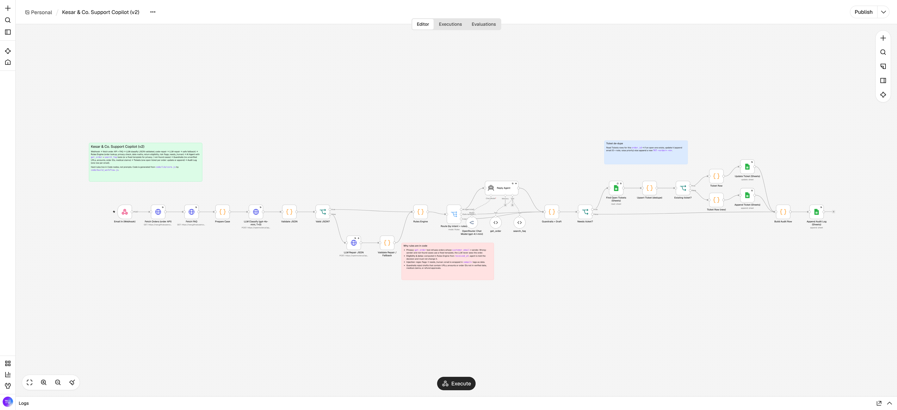

# Kesar & Co. Support Copilot — _<your name>_

## 1. Summary

- **What I built:** an n8n workflow that receives each support email on a webhook and has an LLM classify it into schema-valid JSON. Code then applies the business rules: order lookup, privacy check, date maths, return eligibility and risk flags. A tool-using AI agent (`get_order`, `search_faq`) drafts the reply, and a guardrail checks the draft. Return/refund and complaint emails open or update a de-duplicated ticket, and every email gets one row in the Audit Log.
- **Platform and LLM:** n8n (built and tested on self-hosted n8n 2.49.5; imports into n8n Cloud). OpenRouter with `openai/gpt-4o-mini` for classification (T=0, JSON mode) and `openai/gpt-4.1-mini` for the reply agent (T=0.3).
- **Time spent:** _<fill in>_
- **Works:** all 25 emails ran through the n8n webhook with 25/25 correct intents, 24/25 correct actions, 25/25 valid JSON on the first try, 9 tickets (E04 and E21 merged into one) and 14 emails sent to "needs human". Hindi and Hinglish replies work. Tokens and cost are tracked.
- **Doesn't / weak spots:** see [TEST_REPORT §5](TEST_REPORT.md#5-failures-i-could-not-fix-be-honest). E24 is over-escalated. The agent sometimes skips `search_faq` on medical questions (the draft is still held for a human). In the test run the Google Sheets nodes were swapped for in-memory stubs, because the test sandbox had no Google login; the real Sheets nodes are configured but were first run by _<you, on your instance>_.

## 2. Architecture



| Step / node | What it does | Why I designed it this way |
|---|---|---|
| **Email In (Webhook)** | `POST /webhook/kesar-support`, body = one email object | Matches `scripts/send_test_emails.py`. Responds immediately so the sender doesn't time out |
| **Fetch Orders / Fetch FAQ** | HTTP GET of `orders.json` and `faq.md` from the assignment repo | Treated as a read-only order API, with retry on fail |
| **Prepare Case** | Validates the webhook body and builds the classification request | Keeps the prompt in one place |
| **LLM Classify** | OpenRouter, gpt-4o-mini, T=0, `response_format: json_object` | A cheap, fast model is enough for triage. JSON mode cuts down invalid output |
| **Validate JSON → Valid JSON? → LLM Repair → Fallback** | Validates against `schemas/llm_output.schema.json`. Tries a code repair first (case, `kc 1041` → `KC-1041`, `95` → `0.95`), then one LLM repair call with the error list, then a safe fallback (`intent: other`, confidence 0, needs_human) | Output is always schema-valid. The flow never crashes and never guesses |
| **Rules Engine** (Code) | Checks the order ID against the email text with a regex, looks up the order by ID then by sender email, checks `customer_email == sender`, works out days since delivery from `received_at`, applies FAQ §4/§5/§6 (eligibility, refund route, non-refundable fees), sets risk flags (injection, medical, public threat), and decides action, ticket, priority and needs_human | Hard rules in code, not prompts. A model can be talked out of a rule; an IF statement can't |
| **Route (by intent + rules)** | Switch: *AI agent draft* / *Safe template* (wrong sender, order not found) / *Log only* (intent `other`) | In privacy and not-found cases the LLM never sees order data |
| **Reply Agent** + `get_order` + `search_faq` | n8n AI Agent (gpt-4.1-mini). It gets trusted CASE FACTS (policy decision, language, verified order ID) and the untrusted email inside `<email>` tags. The agent decides which tools to call | `get_order` enforces ownership in code. `search_faq` splits the FAQ by heading (each product row is its own chunk) and does keyword plus synonym scoring, so answers stay grounded in the FAQ and the retrieval is easy to inspect. Vector search would be overkill for a 9-section FAQ |
| **Guardrails + Draft** | Rejects drafts containing URLs, ₹ amounts or order IDs that aren't in verified data, cure/treat claims, "refund approved" without eligibility, emoji, or a missing sign-off. A failed draft goes to needs_human | A second line of defence against hallucination and injection |
| **Needs ticket? → Find Open Tickets → Upsert Ticket → Update / Append** | Reads Tickets rows for this `order_id`. If an open ticket exists, appends the email ID and a note and raises the priority; otherwise appends `TKT-<order>-<n>` | One open ticket per order. IDs need no global counter |
| **Build Audit Row → Append Audit Log** | One row per email with all template columns, plus `tokens` and `cost_usd` | The `notes` column records the reasons behind each decision (flags, why needs_human, JSON path, tools used) |

The rule code lives in **`code/lib/core.js`**. `code/build_workflow.js` copies those functions into the n8n Code nodes, so the workflow and the local harness (`code/run_local.js`) run the same logic. `code/test_core.js` covers the rules with assertions.

## 3. Setup — how someone else can run this

1. **Accounts and credentials** (no keys are in this repo): an n8n Cloud trial or self-hosted n8n (≥ 2.x, Node 24), an OpenRouter API key, and a Google account for Sheets.
2. **Import:** n8n → *Workflows → Import from file* → `workflow/kesar_support_copilot.json`.
3. **Credentials and configuration:**
   - Create an **OpenRouter** credential and select it on *LLM Classify*, *LLM Repair JSON* and *OpenRouter Chat Model*.
   - Create a Google Sheet named **Kesar Support** with tabs **Audit Log** and **Tickets**. Import the headers from the assignment's `templates/` folder and add two extra Audit Log columns, `tokens` and `cost_usd`.
   - Create a **Google Sheets OAuth2** credential. On each of the 4 Sheets nodes, select it and replace `YOUR_GOOGLE_SHEET_ID` with your sheet's ID.
   - Activate (publish) the workflow.
4. **Run the 25 test emails:**
   ```bash
   python scripts/send_test_emails.py --url https://<your-n8n>/webhook/kesar-support
   ```
   Keep the default 5 s delay; ticket de-duplication relies on emails for the same order not running at the same moment.

**Without n8n** (the same logic, writing CSVs to `results/<version>/`):
```bash
OPENROUTER_API_KEY=... node code/run_local.js --version v2
```
```bash
node code/test_core.js
```
After editing `code/lib/core.js` or `prompts/*_v2.md`, regenerate the workflow with `node code/build_workflow.js`.

## 4. Prompts

- Classification (v2): [`prompts/classify_v2.md`](prompts/classify_v2.md). gpt-4o-mini, temperature 0, JSON mode.
- Agent system prompt (v2): [`prompts/agent_v2.md`](prompts/agent_v2.md). gpt-4.1-mini, temperature 0.3, max 6 iterations.
- v1 prompts for comparison: [`prompts/classify_v1.md`](prompts/classify_v1.md), [`prompts/agent_v1.md`](prompts/agent_v1.md).

The agent's user message is built in the Rules Engine: `CASE FACTS` (trusted JSON with the policy decision, verified order ID, language and ticket status), then the email inside `<email>` tags, labelled untrusted.

## 5. Key decisions and assumptions

- **Low confidence:** confidence below **0.75** → needs_human. gpt-4o-mini returned 0.85–0.95 on clear emails, and the vague ones (E18 "Where is it???") scored lower. I don't rely on confidence alone, because models are overconfident. Deterministic triggers also send emails to a human: injection, medical, public threat, angry, order not found, wrong sender, policy decline, damage claims, and guardrail failures.
- **Duplicate tickets:** before appending, the flow reads Tickets rows with the same `order_id` and status ≠ `Closed`. If one exists it updates that row, adding the email ID to `email_ids`, appending a timestamped note and keeping the higher priority. E04 and E21 → `TKT-1052-1`.
- **Order details only to the owner:** enforced in three places. The Rules Engine routes wrong-sender cases to a template; the `get_order` tool refuses other customers' orders; the guardrail rejects any URL or order ID not verified for that sender. With no order ID, the flow looks up by sender email and picks the most recent order, flagging a human if there are several.
- **Grounded in the FAQ:** the agent must use `search_faq` and answer only from what it returns, and `NO_MATCH` means "NEEDS_HUMAN". Policy decisions come from code. The guardrail allows only amounts that appear in the order or the FAQ.
- **Other assumptions:** "today" is each email's `received_at` date (IST). The 48-hour damage window is counted in calendar days because orders have no delivery time. `other` emails get no reply draft. Damage, wrong and missing claims are `complaint` with priority High. Replies are drafts only.

## 6. Scaling to 1,000 emails/day

- **What breaks first:** the webhook runs each email straight away, so bursts hit OpenRouter rate limits, and two emails on the same order can race on ticket de-duplication. Google Sheets has its own limits (about 60 writes per minute per user) and isn't a database.
- **Changes:**
  1. Put a queue in front (n8n queue mode with Redis workers, or a "Kesar inbox" table with status) and process orders one at a time.
  2. Move tickets and the audit log to Postgres or a real helpdesk (Freshdesk, Zendesk) with a unique open-ticket constraint per order.
  3. Replace the raw-file order API with Shopify's API, with caching.
  4. Keep retries with backoff (already on) and add a dead-letter path.
  5. Monitor: daily needs_human rate, guardrail-failure rate, JSON fallback rate, cost per email, and a sample of drafts reviewed by a human each week.
  6. Cache the FAQ and prompts (prompt caching cuts the cost of the repeated system prompt).

## 7. Product-thinking questions

1. **Auto-send vs. draft:** I'd auto-send only order-status replies where the order is verified for the sender, the status is shipped, out for delivery or delivered, no flags are raised, confidence is at least 0.85 and the guardrail passes (E01, E10, E15), plus product answers from FAQ sections that never change (E02). In this test set that's about 25% of email. Anything involving money (refunds, declines, damage), anything angry, medical, injection-flagged or not found stays a draft. I'd set the auto-send threshold higher (0.85) than the needs-human threshold (0.75), because a wrong auto-sent reply costs more than a human glance. I'd revisit both after measuring edit rates.

2. **Cost:** measured with OpenRouter `usage.cost`: classification about 1,100 tokens ≈ $0.0002, agent turns about 2,000–4,500 tokens ≈ $0.0009, so **≈ $0.0011 per email** (≈ ₹0.09 at ₹85/$). Log-only and template emails cost about $0.0002. At 1,000 emails/day: $1.1 × 30 ≈ **$33 a month (≈ ₹2,800)**, or about $40 with retries and repairs. That is tiny next to one agent's salary, so model choice should be driven by quality, not cost.

3. **Success metric:** the **edit rate on drafts**: the share of drafts a human sends with no or minor edits, by intent. It measures usefulness and safety at once. Week-1 target: at least 70% on order-status. I'd switch it off on any privacy leak (order data sent to the wrong person), any invented refund or policy promise reaching a customer, or an edit rate below 40% (it then costs the agent more time than it saves).

4. **Failure experience:** the worst case is a confident wrong answer: a wrong date, a promised refund, or someone else's data. To limit the damage: risky categories are drafts only; hard rules are in code; the guardrail blocks unverified facts; replies avoid exact commitments ("a team member will follow up within 24 business hours"). Every reply is linked to an audit row so a mistake can be traced and corrected quickly with an apology. Ticket notes keep context so the customer never has to repeat themselves.

5. **Don't automate:** **declining a refund or return** (E12, E16). It's money, the customer is already unhappy, and goodwill exceptions such as a partial refund or a free sample for a loyal customer are judgment calls that rules can't make. The copilot can work out eligibility and draft the reply, but a person should press send.

## 8. How I used AI tools

_<Describe your own use honestly. For example:>_ I used Claude (Claude Code) to scaffold the workflow generator, the rule code, the local test harness and the first drafts of the prompts and this write-up. I decided the architecture myself (rules in code, privacy enforced in the tool, template branch), checked every expected outcome in the test report against `faq.md` and `orders.json`, and reviewed every draft. Testing turned up the unreliable `injection_suspected` flag and the v1 privacy and injection failures, and I changed the design because of them.

## 9. If I had one more week

- A grounding checker (a second small-model pass, or a sentence-to-FAQ match) to catch unsourced phrases like the one in E20
- Escalate on deterministic anger signals rather than model sentiment (E24)
- A Slack or email approval step for needs_human drafts, with one-click send
- Move tickets to a real helpdesk and run the workflow in queue mode
- A small labelled eval set (these 25 emails plus about 50 variants) run in CI whenever a prompt changes

## Repo layout

```
workflow/kesar_support_copilot.json   n8n export (no secrets; credential IDs are placeholders)
code/lib/core.js                       all deterministic rules (single source of truth)
code/build_workflow.js                 generates the n8n JSON from core.js + prompts
code/run_local.js                      same pipeline outside n8n (CSV output)
code/test_core.js                      assertions for the rules
prompts/                               v1 and v2 prompts
results/v2_n8n/                        run of record: 25 emails through n8n (audit_log.csv, tickets.csv)
results/v1/                            v1 run on 12 emails
screenshots/                           workflow.png, tickets.png, audit_log.png
data/, schemas/, scripts/              from the assignment (used by the local harness)
```
